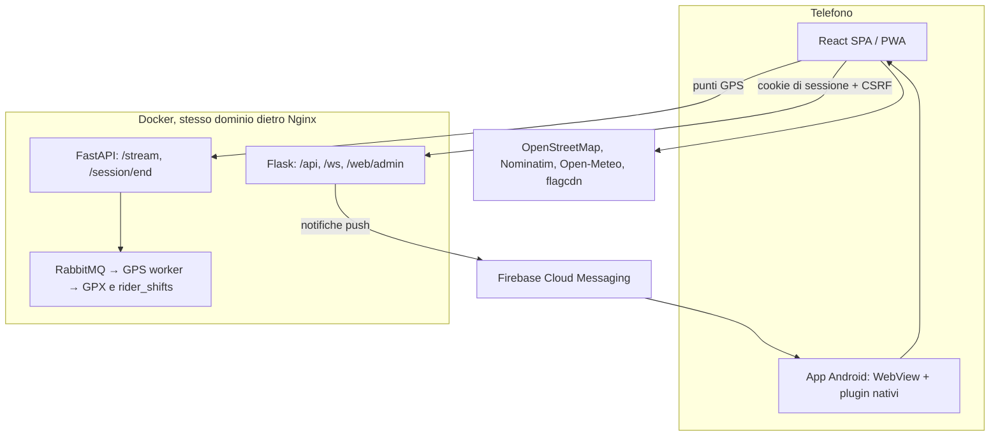

# 📚 Documentazione tecnica del frontend — Rider of Riders (RoR)

Architettura, moduli, stato globale, rete, app Android e test del **frontend React** di RoR, aggiornata al
28/09/2026 (fasi 1–7). Descrive solo ciò che il codice fa davvero: i contratti delle API sono in
[`API_CONTRACT.md`](./API_CONTRACT.md), l'app Android in [`android/README.md`](./android/README.md).

---

## 📑 Indice
1. [Panoramica](#1-panoramica)
2. [Stack tecnologico](#2-stack-tecnologico)
3. [Struttura del progetto](#3-struttura-del-progetto)
4. [Routing e protezione delle pagine](#4-routing-e-protezione-delle-pagine)
5. [Stato globale, lingue e testi](#5-stato-globale-lingue-e-testi)
6. [Rete: sessione, CSRF, WebSocket e ingestione GPS](#6-rete-sessione-csrf-websocket-e-ingestione-gps)
7. [Pagine](#7-pagine)
8. [Sessione GPS, rilevamento cadute e SOS](#8-sessione-gps-rilevamento-cadute-e-sos)
9. [App Android (Capacitor)](#9-app-android-capacitor)
10. [Design system e accessibilità](#10-design-system-e-accessibilità)
11. [PWA, service worker e modalità offline](#11-pwa-service-worker-e-modalità-offline)
12. [Moduli di utilità](#12-moduli-di-utilità)
13. [Gestione degli errori](#13-gestione-degli-errori)
14. [Comandi e test](#14-comandi-e-test)
15. [Bici della community e QR code](#15-bici-della-community-e-qr-code)

---

## 1. Panoramica

**Rider of Riders (RoR)** è un'app per chi lavora in bici (rider e ciclofattorini): registra i percorsi con il GPS del
telefono, rileva le cadute con accelerometro e giroscopio e invia SOS, gestisce consegne e guadagni, gruppi con chat e
posizione condivisa e le bici della community con QR code. Ogni schermata legge e salva dati reali del backend Flask:
nessun dato simulato (`src/__tests__/optimizationArchitecture.test.js` vieta il contenuto inventato in `src/`).

Lo stesso codice React gira in tre modi:
- **browser** e **PWA installata** (servite da Nginx insieme al backend, stesso dominio);
- **app Android** (Capacitor): una WebView che apre lo stesso sito, con in più GPS e cadute a schermo spento e notifiche
  push (sezione 9).



## 2. Stack tecnologico

| Componente | Tecnologia | Versione | Note |
| :--- | :--- | :--- | :--- |
| UI | React | 18.3 | componenti funzione e custom hook |
| Build | Vite | 8 (Rolldown) | `@vitejs/plugin-react` 5.2 |
| Routing | React Router DOM | 7 | code splitting con `lazy` |
| Mappe | Leaflet | 1.9 | tessere OpenStreetMap, ricerca Nominatim, POI dal backend |
| PWA | vite-plugin-pwa (Workbox) | 1.3 | precache, avvio offline, cache delle tessere |
| QR code | uqr | 0.1 | SVG generati nel telefono (nessun servizio esterno) |
| App Android | Capacitor | 8 | `@capacitor/app`, `@capacitor/push-notifications`, `@capacitor-community/background-geolocation` |
| Test | Vitest 5 + Testing Library, Playwright | — | e2e con Edge (`E2E_BROWSER_CHANNEL=msedge`) |
| Font | @fontsource (Audiowide, Plus Jakarta Sans, Syne) | — | inclusi nella build, niente Google Fonts |

## 3. Struttura del progetto

```text
FrontendReact/
├── android/                 # progetto Android (Capacitor): plugin locali RorMotion e RorSystem, README
├── native-shell/            # pagine locali dell'app (index e "nessuna connessione")
├── capacitor.config.js      # id com.ror.rider, server.url = sito RoR (CAP_SERVER_URL)
├── e2e/                     # Playwright: navigazione, consegne admin→rider, chat tra 2 browser, PWA offline, aggiornamento
├── public/                  # icone PWA, immagini della Home, avatar segnaposto
├── scripts/                 # check-sw.mjs (build), generate-icons.mjs, android-sync.mjs
├── src/
│   ├── App.jsx              # provider, router, rotte pubbliche/protette, NativeAppBridge
│   ├── components/          # BottomNavbar, HeaderBanner, Modal (markup sanificato), Toast, PushBanner,
│   │                        # OfflineBanner, SafetyOverlay (caduta/SOS), GroupChat, ProtectedRoute,
│   │                        # ErrorBoundary, PhoneFrame, DevToolbar (solo npm run dev), NativeAppBridge
│   ├── content/             # testi lunghi it/en/es: guida (Info), privacy, eliminazione account
│   ├── context/             # AppContext, RideTrackingContext, NotificationsContext, i18n/{it,en,es}.js
│   ├── hooks/               # useWebSocket (riconnessione + ping/pong)
│   ├── native/              # solo app Android: platform, http, location, motion, push, pushState, system, appState
│   ├── pages/               # 26 schermate (sezione 7)
│   ├── services/            # un servizio per area dell'API (api.js + auth, profile, stats, route, group,
│   │                        # map, tracking, sos, order, rider, notification, bike, chat, account, device)
│   ├── styles/              # 14 fogli CSS: core/ (variabili, reset, layout), components/, pages/
│   ├── tracking/            # FallDetector, SignalProcessor, geo (filtri delle posizioni)
│   └── utils/               # audio, auth, export, codice fiscale, geohash, immagini, meteo, statistiche, tastiera
├── API_CONTRACT.md          # contratto completo con il backend
└── vite.config.js           # proxy di sviluppo verso https://localhost, PWA, chunk vendor
```

## 4. Routing e protezione delle pagine

`App.jsx` definisce le rotte con React Router 7. Pubbliche: `/login`, `/register`, `/accedi`, `/info`, `/privacy`,
`/eliminazione-account`, `/lingua`, `/bici`, `/bici/:bikeId` (e il vecchio `/bike/:id` che vi reindirizza). Tutte le
altre sono avvolte da `ProtectedRoute`. Le pagine usate spesso vengono precaricate con `requestIdleCallback`.

`ProtectedRoute` si basa su `authStatus` di `AppContext`, cioè sulla sessione verificata dal server
(`GET /api/auth/session`): mentre la verifica è in corso mostra il caricamento, senza sessione porta a `/login`
ricordando la pagina richiesta. Il pannello admin Flask (`/web/admin/`) senza sessione rimanda a `/accedi?next=...` e
React torna lì dopo il login (`adminReturnPath` in `utils/authUtils.js`).

## 5. Stato globale, lingue e testi

- **`AppContext`**: profilo (`userProfile`, `authStatus`), tema chiaro/scuro, lingua, modali, toast, banner delle
  notifiche e stato della rete. Hook dedicati per evitare re-render: `useTheme`, `useI18n`, `useAuth`, `useUI`,
  `useNetwork` (e `useApp` con tutto). Nel `localStorage` resta una copia del profilo **senza** codice fiscale, telefono
  e dati di nascita (`profileForStorage`).
- **`RideTrackingContext`**: sessione di guida, GPS, cadute, SOS e SOS dei gruppi (sezione 8).
- **`NotificationsContext`**: notifiche del server ogni 30 s (ogni 2 minuti nell'app Android con le push attive), contatore
  dei non letti, banner per le nuove.
- **Lingue**: `context/i18n/{it,en,es}.js` con 667 chiavi ciascuno; uso `t.chiave || 'testo italiano'`. I testi lunghi
  (guida, privacy, eliminazione account) sono in `src/content/` nelle tre lingue; la guida ha varianti per l'app Android.

## 6. Rete: sessione, CSRF, WebSocket e ingestione GPS

- **Autenticazione**: cookie di sessione di Flask-Security, **niente JWT**. `services/api.js` usa
  `credentials: 'include'` e invia il token CSRF in `X-CSRFToken` (da `GET /api/auth/csrf` o dalle risposte); con
  `csrf_error` ne chiede uno nuovo e riprova una volta. Un `401` emette l'evento `ror:unauthorized` e l'app torna al login.
- **Normalizzazione**: le risposte passano da `snake_case` a `camelCase` (tranne `raw: true`). Errori come `ApiError`
  con `status`, `code` e `fields` (formato uniforme `{error, message, fields?}`).
- **Richieste da background** (solo app Android): `/stream`, `/session/end` e `POST /api/sos` usano
  `native/http.js` (HTTP nativo di Capacitor, stessi cookie).
- **WebSocket**: `useWebSocket` (stesso dominio, `wss://`), ping ogni 25 s, riconnessione automatica. La chat di gruppo
  (`components/GroupChat.jsx`) usa `/ws/chat/<id>` per ricevere, mostra chi sta scrivendo e recupera i messaggi persi
  alla riconnessione. I messaggi partono sempre via HTTP (conferma o errore, il testo resta se l'invio fallisce): un
  WebSocket "connesso" può essere morto da 30 s dopo un cambio di rete e il messaggio spariva senza avviso.
- **Ingestione GPS**: `services/trackingService.js` invia i punti a FastAPI (`POST /stream`, a blocchi) e chiude la
  sessione con `POST /session/end`; il GPS worker scrive GPX e percorso.

## 7. Pagine

| Pagina | Cosa fa (dati reali) |
| :--- | :--- |
| `Login`, `Register`, `Accedi` | benvenuto; registrazione con codice fiscale calcolato dai comuni ISTAT del server (o manuale per i nati all'estero e in comuni soppressi o fusi); login con blocco dopo 10 errori |
| `Home` | sessione GPS (VAI, pausa, termina), SOS, SOS dei gruppi, meteo Open-Meteo nella posizione del telefono, bici collegata |
| `Statistiche`, `VelocitaMedia`, `TempoTotale`, `PunteggioTotale` | statistiche da `/api/stats` (percorsi GPS; Tempo Totale divide tempo in movimento e pause), consegne e punteggio (10 pt/km, 20 per consegna, 5 se puntuale) |
| `Percorsi` | storico dei percorsi, mappa, GPX, eliminazione |
| `Mappa` | Leaflet: POI del backend per geohash, percorso scelto, posizioni del gruppo, ricerca indirizzi, SOS |
| `Consegne`, `PanoramicaUscite` | ordini (accetta, ritira, consegna, rinuncia), guadagni per giorno ed esportazione CSV |
| `Gruppi`, `GruppoChat` | crea/entra con codice o link d'invito, ruoli, chat in tempo reale, posizione dei membri |
| `Notifiche` | notifiche del server (letta/non letta, elimina) |
| `BikeHub`, `BikeStoryPage` | elenco e scheda pubblica delle bici con statistiche reali, "Usa questa bici", QR |
| `Profilo`, `Posizione`, `Impostazioni`, `Lingua` | dati personali, contatti SOS, password, sensori e condivisione posizione, tema, suoni, lingua |
| `Privacy`, `EliminazioneAccount`, `DeleteAccountFlow` | informazioni privacy dal server, download dei dati (JSON), pagina pubblica e flusso di eliminazione |
| `Info`, `Altro` | guida delle funzioni reali, menu (con il link al pannello admin per gli amministratori) |

## 8. Sessione GPS, rilevamento cadute e SOS

`RideTrackingContext` è globale, così la sessione continua cambiando pagina:
- **Posizioni** filtrate (`tracking/geo.js`: precisione ≤ 50 m, niente salti oltre 90 km/h), inviate a blocchi ogni
  20 s (controllato anche all'arrivo di ogni posizione) con nuovi tentativi nello stesso ordine e al massimo 200 punti per
  richiesta (gli arretrati dopo un tratto senza rete partono in più blocchi); la sessione e i punti non inviati restano
  nel `localStorage` e dopo un ricaricamento la sessione torna in pausa.
- **Cadute**: 20 campioni al secondo di accelerometro e giroscopio → `SignalProcessor` → `FallDetector` (urto + rotazione +
  immobilità) → conto alla rovescia di 10 s basato sull'orologio → SOS automatico se il rider non preme "Sto bene".
- **SOS** manuale o da caduta (`/api/sos`), con la posizione più recente; i SOS dei membri dei gruppi compaiono in Home e
  sulla mappa (controllo ogni 30 s; nell'app Android con le push attive ogni 2 minuti e subito all'arrivo della push).
- Nel browser GPS e sensori funzionano solo con l'app aperta e lo schermo acceso (Wake Lock); nell'app Android anche a
  schermo spento (sezione 9).

## 9. App Android (Capacitor)

L'app (`com.ror.rider`) apre il sito RoR in una WebView (`server.url`): stesse pagine e stesso cookie. Il codice che
serve solo lì è in `src/native/` e si attiva con `isNativeApp()`; nel browser tutto resta com'era.

| Modulo | Funzione |
| :--- | :--- |
| `location.js` | GPS con `@capacitor-community/background-geolocation`: servizio in primo piano e notifica fissa, anche a schermo spento |
| `motion.js` | sensori per le cadute dal plugin locale `RorMotion` (Java, 20 Hz, anche a schermo spento) |
| `http.js` | richieste che devono partire in background tramite l'HTTP nativo (la WebView viene rallentata) |
| `push.js` + `components/NativeAppBridge.jsx` | permesso notifiche, token Firebase registrato su `/api/devices`, canali per categoria, tocco sulla push → pagina indicata, link d'invito e QR (App Links), tasto Indietro |
| `system.js` | plugin locale `RorSystem`: GPX/CSV/JSON con il menu "Condividi" (la WebView non scarica file) e avviso di caduta di Android |
| `appState.js` | app in primo piano o no (nella WebView `visibilityState` resta sempre "visible") |
| `pushState.js` | push attive o no su questo telefono: con le push notifiche e SOS dei gruppi si controllano ogni 2 minuti e Consegne ogni 60 s (invece di 30/30/20 s); una push ricevuta con l'app aperta o il ritorno in primo piano ricaricano subito i dati (`requestRefresh`) |

Altre differenze: accesso sempre con "Ricordami" (Capacitor cancella il cookie di sessione a ogni avvio), testi della
guida e dei permessi adattati, User-Agent `RoR-Android/<versione>`. Build, firma e distribuzione ai tester:
[`android/README.md`](./android/README.md).

## 10. Design system e accessibilità

- Variabili in `styles/core/variables.css` con tema chiaro e scuro (`body.theme-dark`), token di contrasto
  `--text-success` / `--text-danger`; contrasto verificato su tutte le schermate in entrambi i temi (WCAG 1.4.3).
- Zoom consentito; `aria-label` coerenti con il testo visibile; gli elementi `role="button"` rispondono a Invio e Spazio
  (`utils/keyboardButtons.js`); `prefers-reduced-motion` rispettato.
- Su telefono e nella PWA installata l'app occupa tutto lo schermo (niente cornice del telefono simulato).

## 11. PWA, service worker e modalità offline

- Manifest con icone PNG (anche maskable), avvio `standalone`, orientamento verticale.
- Workbox: precache di tutti gli asset (JS, CSS, HTML, immagini, font) → l'app si apre anche senza rete; cache delle
  tessere OpenStreetMap (30 giorni, 1000 tessere). Le rotte del backend (`/api`, `/ws`, `/web`, `/stream`, `/session`)
  non passano mai dal fallback della SPA.
- `npm run build` esegue `scripts/check-sw.mjs`: fallisce se la precache contiene file duplicati (Workbox resterebbe
  senza cache). `OfflineBanner` avvisa quando la rete manca e quando torna.

## 12. Moduli di utilità

- `authUtils.js`: forza della password, preferenza "Ricordami", ritorno al pannello admin dopo il login.
- `fiscalCodeUtils.js`: calcolo e validazione del codice fiscale (lo stesso algoritmo verifica il backend in `app/auth/tax_id.py`).
- `exportUtils.js`: CSV e JSON scaricati nel browser, condivisi nell'app Android.
- `audioUtils.js`: suoni sintetizzati con Web Audio (notifiche, ordini, SOS, chat) secondo le preferenze.
- `geohash.js`, `statsFormat.js` (etichette con `Intl`), `weatherUtils.js` (coordinate arrotondate a ~1 km),
  `imageUtils.js` (foto profilo ridimensionata), `keyboardButtons.js`.

## 13. Gestione degli errori

`ErrorBoundary` avvolge l'app: in caso di errore di rendering mostra una schermata di recupero nella lingua scelta con
"Ricarica" e "Torna alla Home"; i dettagli tecnici compaiono solo in sviluppo (`import.meta.env.DEV`). Dopo un
aggiornamento del server i file JS della versione precedente non ci sono più: chi aveva l'app aperta e apriva una pagina
non ancora caricata vedeva questa schermata. `utils/chunkReload.js` (registrato in `main.jsx`) ascolta l'evento
`vite:preloadError` e ricarica l'app una volta (non di nuovo entro 10 s, per non andare in ciclo); nel frattempo la
schermata mostra "Aggiornamento dell'app in corso...". Gli errori delle
API arrivano all'utente come messaggi comprensibili (`authErrorMessage`) o come stato di errore con "Riprova".

## 14. Comandi e test

```bash
npm run dev                 # sviluppo con proxy verso lo stack Docker (https://localhost)
npm test                    # Vitest: 60 file di test, 372 test (06/10/2026)
npm run build               # build di produzione + controllo del service worker
E2E_BROWSER_CHANNEL=msedge npx playwright test   # e2e con account reali creati e cancellati dai test
npm run android:sync        # progetto Android con CAP_SERVER_URL (vedi android/README.md)
```

I test unitari coprono servizi, pagine, contesti (anche la sessione GPS nell'app Android con timer rallentati),
architettura (contratto API documentato, servizi esterni dichiarati nella Privacy, nessun contenuto inventato, PWA) e
accessibilità. Gli e2e (`e2e/`) provano navigazione con un rider reale, ordine dal pannello admin fino alla consegna,
chat in tempo reale tra due browser, apertura della PWA senza rete e ricarica automatica quando, dopo un aggiornamento
del server, manca il file di una pagina della versione precedente. La build iniziale scarica circa 415 kB di JS
(React e il codice condiviso dell'app); le altre pagine arrivano su richiesta.

## 15. Bici della community e QR code

Ogni bici ha una scheda pubblica (`/bici/<codice>`, visibile anche senza account) con chilometri, CO₂ evitata stimata
(120 g/km) e numero di rider calcolati dai percorsi reali registrati con quella bici. Chi ha un account preme "Usa questa
bici" per collegarla: i percorsi successivi vengono conteggiati per quella bici e il rider precedente riceve una notifica.
Il QR della scheda è generato nel telefono (`uqr`) e punta all'indirizzo del sito; nell'app Android lo stesso link apre
direttamente la scheda nell'app (App Links). Il pannello admin stampa i QR delle bici con `segno` lato server.
